# arXiv `cs.AI` Frontier Radar

An automated, serverless literature intelligence radar that maps the daily **arXiv `cs.AI`** pre-print frontier in polar coordinates $(r, \theta)$. Unlike citation-based graphs (e.g., LitMaps, Connected Papers) that suffer from a 3-to-6 month citation cold-start lag, this system identifies paradigm-shifting papers on **Day 0** using **Bounded Causal Novelty** over transformer embeddings.

🔗 **Live Interactive Radar:** **[https://d24ezp0byzkk8w.cloudfront.net/](https://d24ezp0byzkk8w.cloudfront.net/)**

---

## System Architecture

```mermaid
flowchart LR
  subgraph Ingestion ["1. Daily Ingestion (AWS eu-north-1)"]
    EB["EventBridge Cron\n(04:00 UTC Mon-Fri)"] --> L["AWS Lambda (ARM64)\nPython + PyArrow"]
    L -->|Watermark & Raw Batches| S3B[("S3 Bronze\nSnappy Parquet")]
  end

  subgraph Lakehouse ["2. Transformation & ML (GitHub Actions + S3 Silver/Gold)"]
    S3B --> DBT["dbt-duckdb (httpfs)\nDeduplication & QA Tests"]
    DBT --> BGE["BAAI/bge-small-en-v1.5\n+ S3 Silver Vector Cache"]
    BGE --> UMAP["Anchor-Locked Polar UMAP\n& Bounded Causal Novelty"]
    UMAP --> LLM["Gemini 2.5 Flash\nTop-5% Breakthrough Diffs"]
    LLM --> S3G[("S3 Gold Parquet\n& frontier_graph.json")]
  end

  subgraph Delivery ["3. Edge Delivery"]
    S3G --> CF["Amazon CloudFront CDN\nOrigin Access Control"]
    CF --> UI["Interactive Canvas UI\nLineage & Delta Explorer"]
  end
```

---

## Mathematical Formulation

### 1. Area-Preserving Quantile Radial Scaling ($r_i$)
In polar coordinates, disk area grows quadratically with radius ($A = \pi r^2$). Mapping publication timestamps linearly to $r$ crowds recent papers into a dense outer perimeter ring. We map each paper's chronological rank $q_i \in [0, 1]$ via a square-root transformation to guarantee uniform spatial density across the radar:

$$r_i = \sqrt{R_{\min}^2 + (1 - R_{\min}^2) \cdot q_i}$$

### 2. Seamless Angular Projection ($\theta_i$) & Zero-Drift Anchor Locking
Standard 1D dimensionality reduction introduces an artificial discontinuity at $0$ and $2\pi$. We project embeddings $\mathbf{e}_i \in \mathbb{R}^{384}$ onto a median-centered 2D UMAP manifold and extract the polar angle:

$$\theta_i = \operatorname{atan2}(u_{i,y} - \mu_y, \, u_{i,x} - \mu_x) \pmod{2\pi}$$

To prevent daily rotational drift as new pre-prints arrive, historical node angles are persisted in S3 Silver (`umap_anchors.parquet`), and newly ingested papers are projected via similarity-weighted circular interpolation against their top-$k$ historical anchors:

$$\theta_{\text{new}} = \operatorname{atan2}\left(\sum_{m=1}^{k} s_{i,m}^4 \sin(\theta_m), \, \sum_{m=1}^{k} s_{i,m}^4 \cos(\theta_m)\right) \pmod{2\pi}$$

### 3. Bounded Causal Novelty (Node Diameter $D_i$)
A pre-print is novel if it diverges semantically from work published *prior* to its initial `v1` timestamp $t_i$, while still sharing foundational domain coherence with `cs.AI` (suppressing out-of-domain noise):

$$N_i = 1 - \frac{1}{k}\sum_{m=1}^{k} s_{i,(m)}, \quad C_i = \frac{1}{1 + \exp\left(-\alpha (s_{i,(1)} - \tau)\right)}, \quad \text{Score}_i = N_i \cdot C_i$$

where $s_{i,(1)} \ge \dots \ge s_{i,(k)}$ are the top-$k$ cosine similarities strictly within the causal set $\{j : t_j < t_i\}$.

---

## FinOps & Engineering Trade-Offs

* **Zero-Database Medallion Lakehouse (`dbt-duckdb` + S3):** Replaces always-on cloud warehouses (Snowflake/RDS) with `dbt-duckdb` reading and writing ZSTD/Snappy Parquet directly over S3 via `httpfs`, keeping storage and compute costs at **$0.00/month**.
* **Incremental S3 Silver Vector Caching:** Persists computed 384-d embeddings and UMAP anchor coordinates in S3 Silver so daily runs only encode net-new `(arxiv_id, version)` pairs (~60 papers/day).
* **Selective LLM Synthesis:** Restricts generative LLM diff calls to newly arrived papers in the **95th+ percentile of Bounded Novelty**, caching outputs in S3 Silver.
